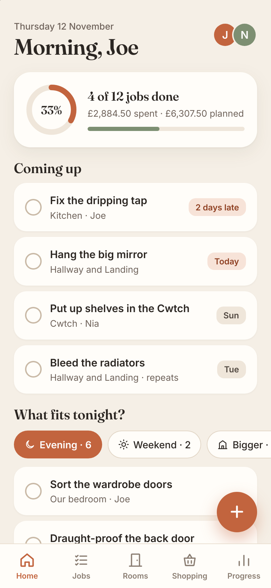
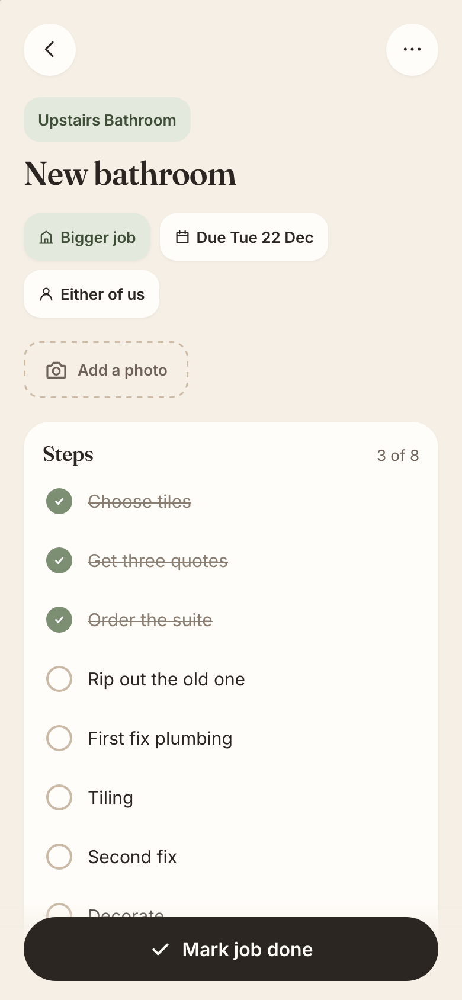
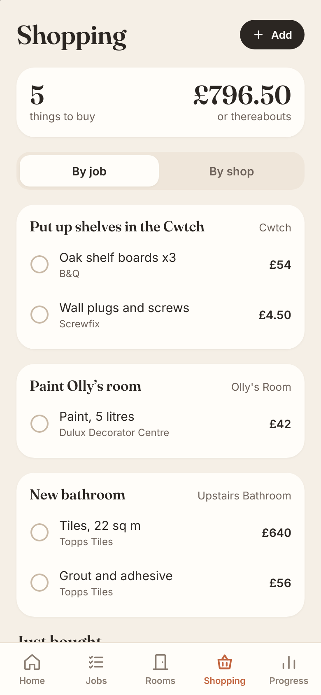
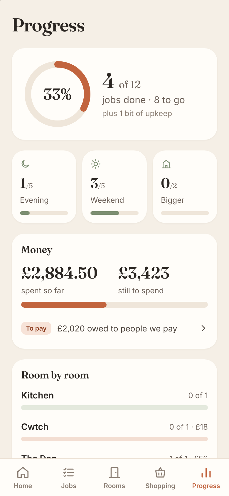

# Nest

A shared home-improvement list for a household. At its simplest it's a list of jobs you tick off. Everything else (rooms, steps, costs, photos, reminders, a progress page) is optional and sits on top.

It's built for the iPhone first: add it to the Home Screen and it behaves like an app, with notifications and a badge. It also works in any browser.

<p>
  
  
  
  
</p>

The screenshots show made-up jobs from `tools/seed-demo.mjs`.

## What it does

**The list**

- **Jobs** need only a title. Each can also have a room, a size (evening, weekend or bigger), a due date, who's doing it, notes, steps to tick off and photos.
- **Home** shows what's coming up and "What fits tonight?": pick evening, weekend or bigger and see the jobs that size.
- **Ideas** hold the "wouldn't it be nice if…" thoughts until one becomes a job.
- **Upkeep** is a job that repeats (bleed the radiators every year). Ticking it done moves the date on from the day it was done.
- **Undo** follows a tick or a delete; deleted jobs wait in a bin.

**Rooms**

- Each room shows what's left in it, its photos, and the things worth remembering: paint colours, bulb types, measurements.
- Rooms can be added, renamed, reordered and archived.

**Money**

- A job has either one rough figure or a list of costs: things to buy (with the shop, ticked off when bought) and bills from people you pay.
- **People we pay** keeps each trade's contact details, their bills and the payments made against them, with what's still owed.
- **Shopping** is every unbought thing across all jobs, by job or by shop.
- Receipts can be photographed onto a cost.

**Reminders**

- One round-up a day per person, at the time they choose: what's due today, what's coming (a day ahead for evening jobs, two for weekend jobs, a week and a day for bigger ones) and the odd nag for late things (day 1, day 3, then weekly).
- A heads-up when the other person finishes a job, or gives you one.
- Each person picks reminders for their own jobs, every job, or none.

**Progress**

- How far along you are overall, by size and room by room; money spent against planned; jobs finished per month; and a timeline of what's been done, with photos.

**Shared Google calendar** (optional)

- Jobs and steps with a date appear in a Google calendar you share, as all-day events. They follow changes and disappear when done. Setup steps are in the app under Settings → Shared calendar and take about ten minutes, once.

**Also:** shared notes (stopcock, boiler model, Wi-Fi), light and dark looks, and sign-in without typing a password on a phone.

## Getting onto a phone

1. Someone with an account makes you a sign-in link (Settings → Who's in the house, or `nest login-link <name>`). It's good for 7 days and one sign-in, and is safe to send by WhatsApp or Messages.
2. Open the link in **Safari** and press **Sign in**.
3. Tap Share → **Add to Home Screen**. The app shows these steps too.
4. Open Nest from the Home Screen. It has its own sign-in, separate from Safari: choose **I have a code** and type the 8-character code from Settings → Sign in another device in Safari (codes last 15 minutes).
5. In Settings → Reminders, turn notifications on. On an iPhone this only works from the Home Screen app.

## Running it

It's one Docker container holding a Node server, the built web app and a SQLite database.

```
git clone https://github.com/zebede1980/Nest && cd Nest
mkdir -p data && sudo chown 1000:1000 data     # the container runs as uid 1000
docker compose up -d --build
docker exec -it nest nest add-user joe --admin --display "Joe"    # asks for a password
docker exec nest nest login-link joe
```

- The app listens on `127.0.0.1:3070` on the host. Put it behind HTTPS: push notifications and installing to the Home Screen need it.
- `docker-compose.yml` is set up for one particular server. Change `APP_URL` to your address (sign-in links and notification taps use it) and the `nginx-proxy-nw` network to suit your reverse proxy.
- Don't put HTTP Basic Auth in front of it: Home Screen apps can't answer the prompt. Nest has its own login.
- Other settings are optional; see `.env.example`.

### Updating

```
git pull && docker compose up -d --build
```

The database upgrades itself on start.

### Backing up

Everything lives in `./data`: `nest.db` and `photos/`. Stop the container so the copy is clean:

```
docker compose stop
sudo tar czf nest-backup-$(date +%F).tgz data
docker compose start
```

The push keys are in the database. If it's lost, every phone has to turn notifications on again.

### Admin commands

Run inside the container as `docker exec -it nest nest <command>`:

| Command | What it does |
| --- | --- |
| `list-users` | Everyone, their role, last sign-in and device count |
| `add-user <name> [--display "Name"] [--admin]` | Adds a person; asks for a password (or reads it from stdin) |
| `set-password <name>` | New password; signs them out everywhere |
| `login-link <name>` | A sign-in link: 7 days, one sign-in |
| `code <name>` | A 15-minute code for the app's "I have a code" |
| `set-display <name> "Name"` / `set-role <name> admin\|member` | Change the shown name or role |
| `delete-user <name>` | Removes the person and their sign-ins; the house's jobs stay |
| `devices <name>` | Their phones and browsers that get reminders |
| `nudges <name> [--send]` | What they'd be reminded of right now; `--send` sends it |
| `sent <name>` | The last notifications they were sent |

Most of this can also be done in the app by an admin, under Settings.

## Developing

Needs Node 22 or newer.

```
npm ci
npm run dev       # web app on http://localhost:3071, API on 3072
npm run check     # svelte-check + tsc
npm test          # vitest, against the real server with an in-memory database
npm run build     # dist/ (web app) and dist-server/
```

| Folder | What's in it |
| --- | --- |
| `shared/` | Types, dates, money sums and the reminder rules, used by both sides |
| `server/src/` | Fastify server: jobs and rooms (`house.ts`), accounts, push, scheduler, Google calendar, admin CLI |
| `client/src/` | Svelte 5 web app: `screens/`, `components/`, `lib/` |
| `tests/` | Server and reminder-rule tests |
| `tools/` | Demo data and headless-browser checks of the screens |

To try it with a house full of made-up jobs, or to check the screens at phone widths, use a scratch copy (never real data: the UI check adds and ticks jobs):

```
npm run build
DATA_DIR=/tmp/nest-scratch PORT=3072 npm start &
echo some-password | DATA_DIR=/tmp/nest-scratch npm run -s admin -- add-user joe --admin
node tools/seed-demo.mjs http://localhost:3072 joe some-password
node tools/check-ui.mjs http://localhost:3072 joe some-password shots
```

The checks drive headless WebKit through `playwright-core` and expect its browser in `~/.cache/ms-playwright`.

`CLAUDE.md` has the design decisions, the rules worth not breaking and the traps already found.

## Built with

Svelte 5, Vite, Fastify 5, Node's built-in SQLite (`node:sqlite`), TypeScript, and Web Push (Declarative Web Push on iOS, a service worker elsewhere). No external services unless you connect the Google calendar.
